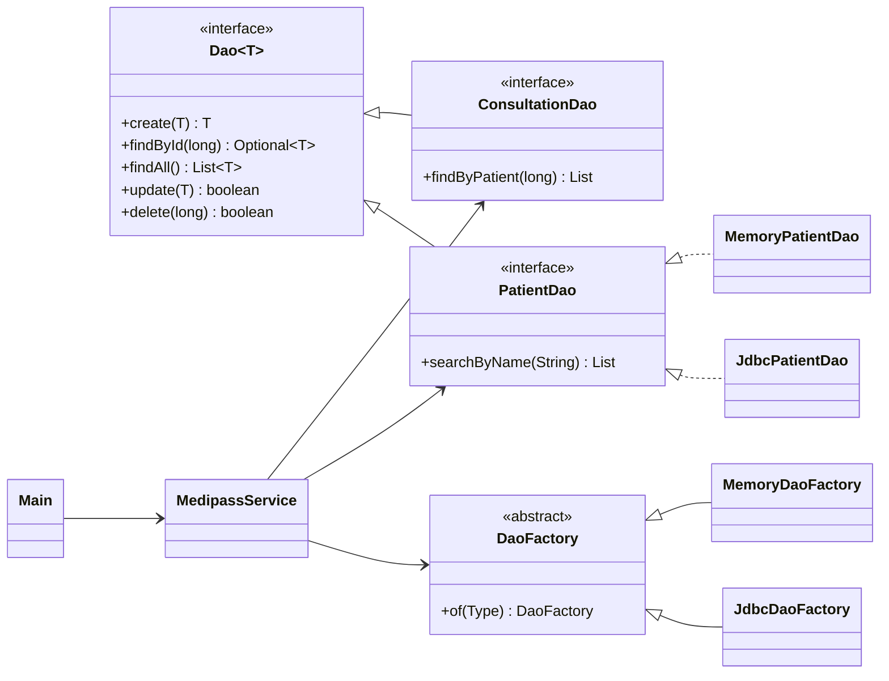
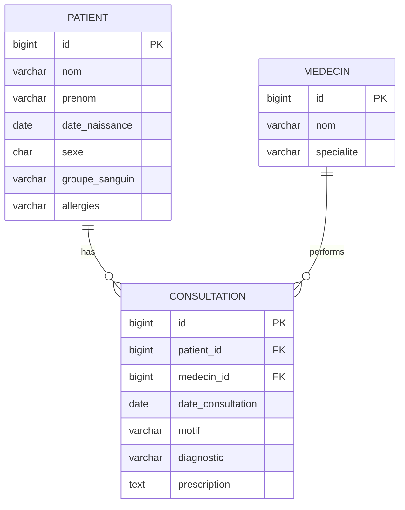

# Medipass — Digital Medical Pass (Java, DAO pattern)

Java application project (**IFRI — Université d'Abomey-Calavi**). Medipass manages a digital medical pass: patients, doctors and the history of consultations. The code is organised around the **Data Access Object (DAO)** pattern, so the storage (MySQL or memory) can be swapped without touching the business logic.

**Stack:** Java 17 · Maven · JDBC · MySQL · JUnit 4 — developed with Eclipse.

## Features

- Patients: register, list, search by name, delete (with their history)
- Doctors: register, list, filter by speciality
- Consultations: date, reason, diagnosis, prescription
- **Medical pass** of a patient: identity, blood group, allergies, and consultations from most recent to oldest
- Business validation: required fields, no future dates, valid blood group, existing patient and doctor
- Two storage modes: **JDBC/MySQL**, or **in memory** (demo, no database needed)

## Architecture



| Layer | Package | Role |
| --- | --- | --- |
| Model | `model` | `Patient`, `Medecin`, `Consultation` (simple POJOs) |
| DAO interfaces | `dao` | generic `Dao<T>` + one interface per entity, `DaoFactory` (Abstract Factory) |
| JDBC implementation | `dao.jdbc` | prepared statements only, generated keys, `ConnectionManager`, `SQLException` wrapped in `DaoException` |
| Memory implementation | `dao.memory` | same interfaces, used for the demo and the unit tests |
| Service | `service` | validation and the `DossierMedical` (medical pass) view |
| App | `app` | console menu, demo data |

The service only knows the interfaces. Switching storage is one line in `medipass.properties`:

```properties
medipass.dao=JDBC      # or MEMORY
```

## Run

**Demo mode** (memory, sample data, no database):

```bash
mvn compile exec:java
```

**With MySQL:**

```bash
mysql -u root -p < sql/schema.sql
# set medipass.dao=JDBC and the credentials in src/main/resources/medipass.properties
mvn compile exec:java
```

In Eclipse: *File > Import > Existing Maven Project*, then run `bj.ifri.medipass.app.Main`.

**Tests:** `mvn test` runs 14 tests on the DAO and the business rules.

## Example

```
==================== MEDIPASS ====================
Patient   : ADJOVI Koffi (n° 1)
Né(e) le  : 12/04/1990  —  36 ans  —  sexe M
Groupe    : O+
Allergies : Pénicilline
--------------------------------------------------
21/10/2026  Dr HOUNGBO (Médecine générale)
   Motif        : Contrôle
   Diagnostic   : Guéri
   Prescription : —
31/07/2026  Dr HOUNGBO (Médecine générale)
   Motif        : Fièvre et courbatures
   Diagnostic   : Paludisme simple
   Prescription : Artéméther-luméfantrine 3 jours
==================================================
```

*(Sample data are fictitious.)*

## Database



---
**Author:** Maël Alain Bradley AZAÏNON — Embedded Systems & IoT, IFRI
